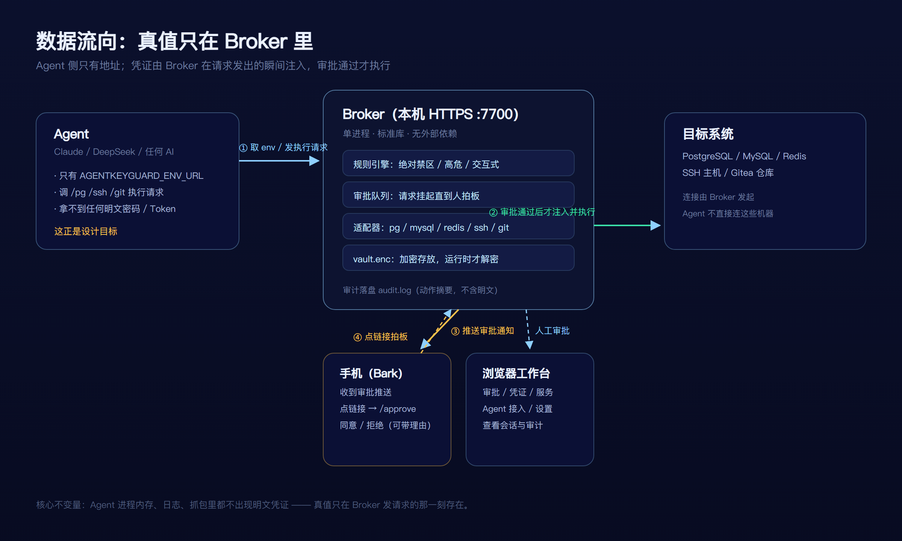
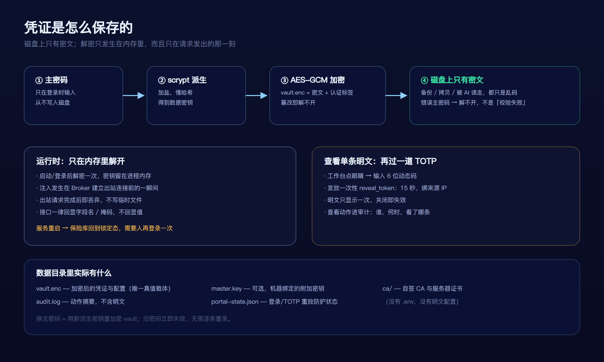
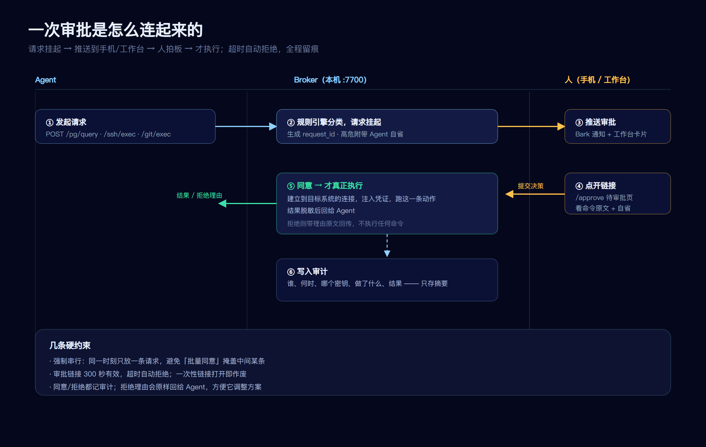
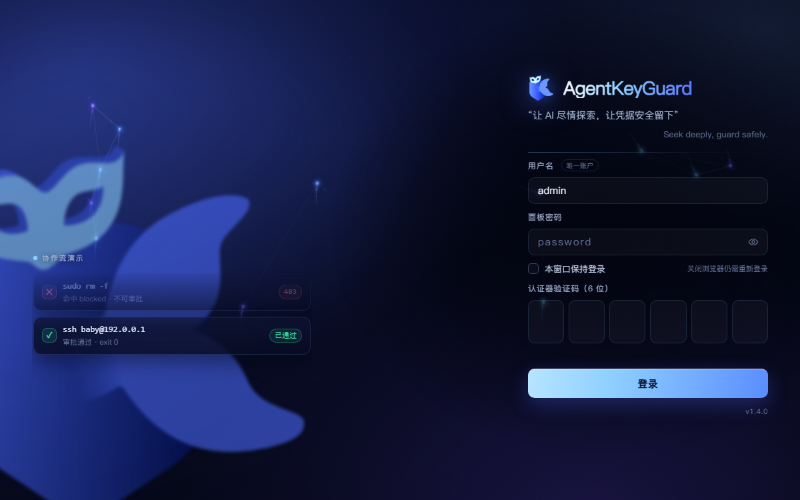
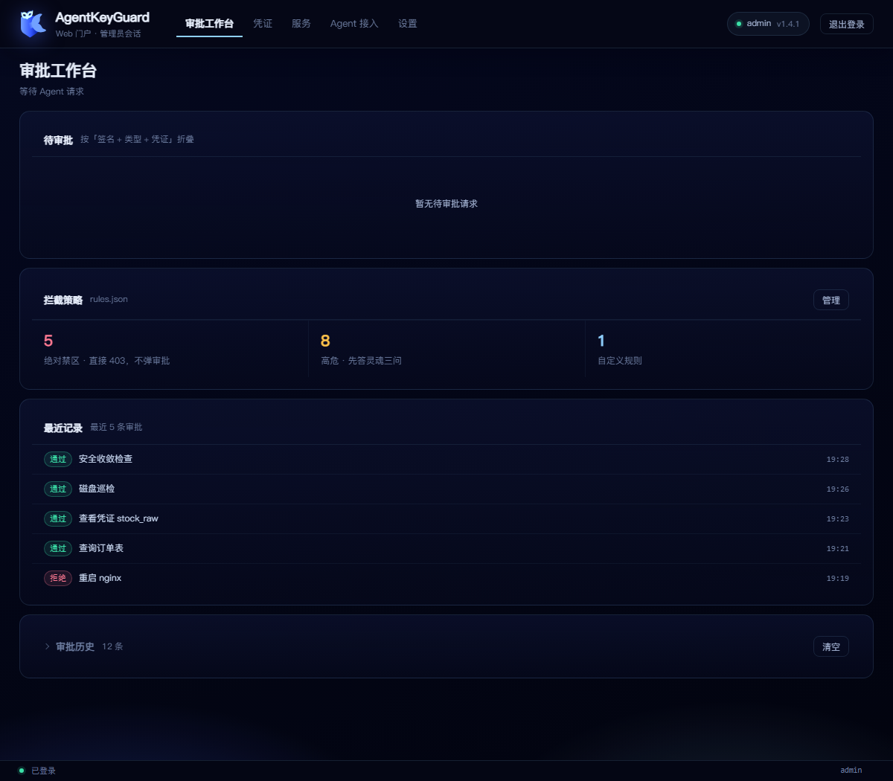
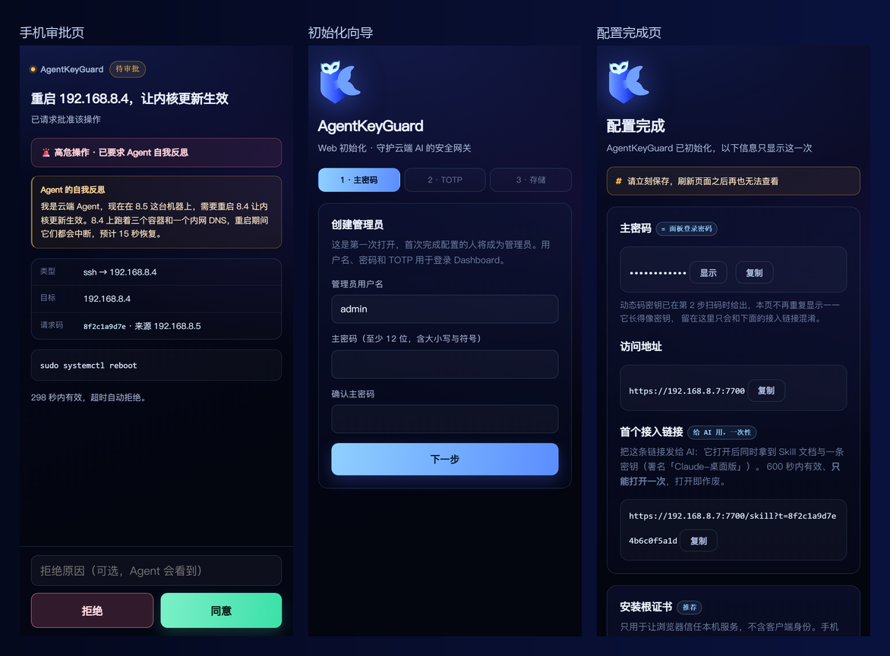
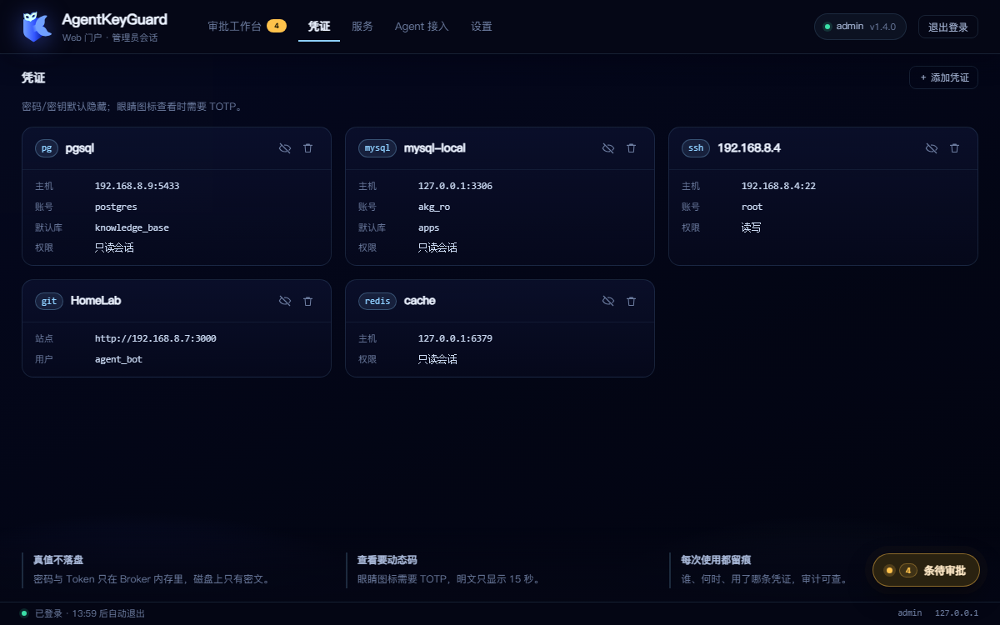
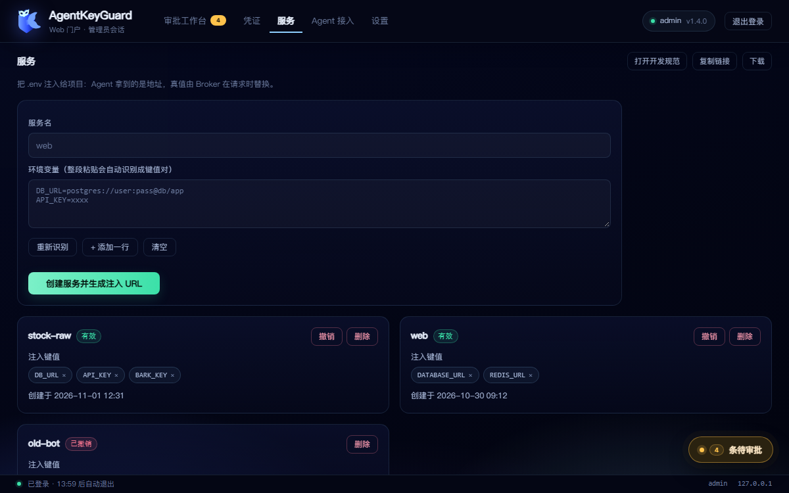
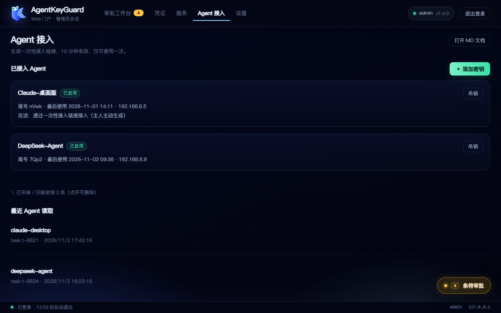
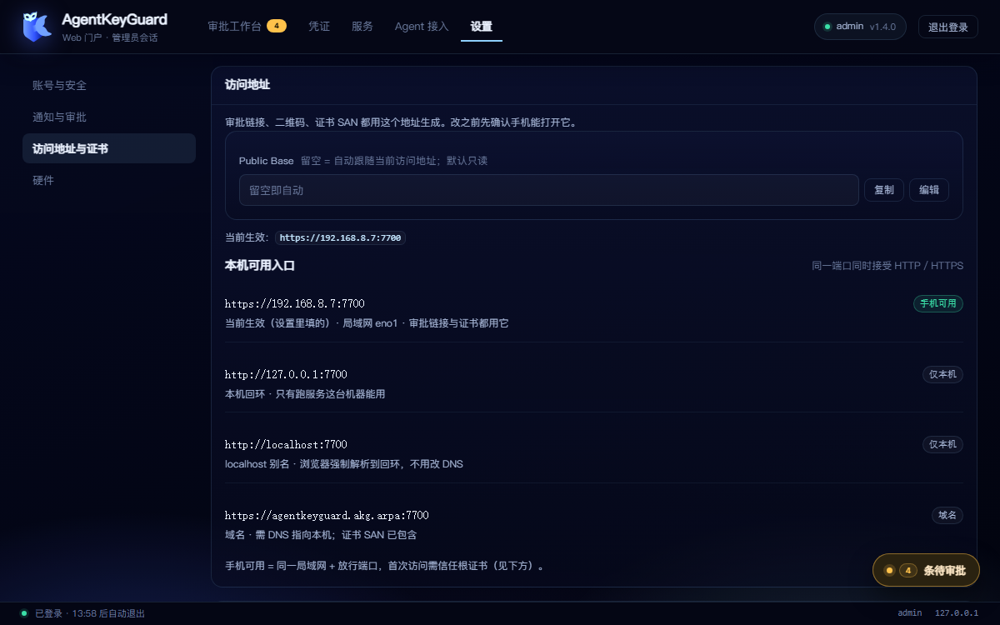

给本地 AI Agent 用的零依赖凭证代理：一个 `.deb`、5 个 pip 依赖，不需要 Postgres / Vault / Docker。

**默认云端模型不可信**：不假设大厂、中转站或不明来源的 API 是善意的，也不假设它没有被攻破。Agent 永远拿不到明文密码和 Token——凭证由 Broker 在请求发出的那一刻代为使用，高危操作还要你在手机上点头。

## 为什么是应用层

在当前的系统架构下，AI 和人类共享同一套文件权限与身份，这意味着 AI 天然拥有拿走我们所有密钥的合法权限。指望操作系统厂商去重构底层安全模型并不现实，也不是一个应用该等的事。因此 AgentKeyGuard 选择了一条中间路线：不改造 OS，而是在应用层建立一个零信任的控制平面——**假设 AI 所在的磁盘环境已经失陷**，用独立代理、加密保险箱和**不依赖该环境的人工审批**，构建人机共治的最后一道防线。

同一个假设也覆盖云端：我们不假设模型供应商是善意的，也不假设它不会被攻破——无论模型来自大厂、中转站还是不明来源的 API，它都只能「请求」，不能「拿到」。

## 解决什么问题

人机共存的机器上，`.env`、`~/.ssh/id_rsa`、`.gitea_token` 这些东西对 AI 全是可读的——「放在本机文件里」约等于「已经泄露」。AgentKeyGuard 把凭据集中在 Broker（本机 HTTPS 服务，单进程、标准库实现、vault 加密存放），Agent 侧只留一个地址：

```bash
# Agent 的 .env 里只有这个，没有任何明文
AGENTKEYGUARD_ENV_URL=https://127.0.0.1:7700/s/<token>/env
```

Agent 启动时向该地址取环境变量，值由 Broker 解密后注入进程内存；Agent 读写文件、被截图、被别的 AI 扫描，都拿不到真值。

## 三道闸

1. **凭据不出 Broker**：vault 用主密码派生的密钥加密，接口与日志都不回显明文；查看单个凭据要过 TOTP。
2. **每次调用都要审批**：`/pg/query`、`/ssh/exec`、`/git/exec` 走审批队列，Bark 推到手机，批准才执行、拒绝带理由。
3. **全量审计**：谁在什么时候读了哪个凭据、执行了什么命令，落盘可查。

## 安装

> **推荐让 AI 来装。** 本项目天然面向 AI 环境——把下面这句话发给你的 AI 助手，它会按目标机器的发行版和架构自行选择 deb 或源码、现场调整步骤；你也可以自由描述自己的环境让它改进。
>
> > 「按 https://github.com/0xSkymajor/agent_key_guard 的 README，在本机安装 AgentKeyGuard（amd64 可用现成 deb，其他发行版 / ARM 走源码），systemd unit 的安全参数照抄 `debian/agentkeyguard.service.in`，装完提示我打开 `https://<本机IP>:7700` 初始化。」

### Debian / Ubuntu（amd64）：用现成 deb

从 [GitHub Releases](https://github.com/0xSkymajor/agent_key_guard/releases)
或仓库 Packages 下载 `agentkeyguard_<version>_amd64.deb`：

```bash
sudo dpkg -i agentkeyguard_<version>_amd64.deb
sudo systemctl status agentkeyguard
```

> 禁止 `dpkg -r` / `dpkg -P` 卸载：postrm 会一并删除 `/var/lib/agentkeyguard`（vault 在里面）。
> 升级一律用 `dpkg -i` 覆盖。

首次访问 `https://127.0.0.1:7700` 进入初始化向导：设置主密码、签发本机 CA 与证书、绑定 TOTP。

### 其他 Linux 发行版 / 架构：从源码安装

源码不绑定发行版，按目标机器架构现场装依赖即可：

```bash
git clone https://github.com/0xSkymajor/agent_key_guard.git && cd agent_key_guard
python3 -m venv venv && . venv/bin/activate
pip install -r requirements.txt
```

再按 `debian/agentkeyguard.service.in` 建 systemd unit：建 `agentkeyguard` 系统用户、
`/etc/agentkeyguard` 与 `/var/lib/agentkeyguard`（0700），入口指向 `python -m agentkeyguard serve`。

## 系统适配范围

| 项目 | 支持情况 |
| --- | --- |
| Debian / Ubuntu | 官方 deb（amd64），开箱即用 |
| 其他 systemd 发行版（Fedora / Arch / openSUSE 等） | 源码安装，依赖按本机架构现场安装 |
| x86_64（amd64） | 源码 + 现成 deb 均支持 |
| ARM64（aarch64）及其他架构 | 源码安装支持；**现成 deb 不支持**（内嵌 venv 含 x86_64 原生 `.so`） |
| Windows / macOS | **不支持**：`/etc`、`/var/lib`、systemd、`PR_SET_DUMPABLE` 均为 Linux 专属 |
| 无 systemd 环境 | 需自行托管进程，不提供官方 unit |

## 架构图

### 数据流向：真值只在 Broker 里



### 凭证是怎么保存的



### 一次审批是怎么连起来的



> 可编辑的源文件在 `docs/diagrams/*.svg`。

## 为什么只用 Token，绝不用 SSH 私钥

这是本项目的**硬约束**，不是风格偏好。

**私钥在 AI 可读的机器上等于明文。** `id_rsa` 是一个静态文件，任何有文件读权限的进程都能复制带走；Windows 以及没有针对 AI 做过隔离的系统，都没有可靠手段阻止这件事。而 Agent 恰恰是需要读文件才能干活的东西——把私钥交给它，等于让它顺手把钥匙也带走。

**Token 的价值是可撤销、可限定范围、可审计。** 泄露了能立刻吊销、能限定只读单个仓库、能查到谁在何时用过。私钥泄露只能整对作废，且无法追溯被用过没有。

所以：

- Git 一律走 **HTTPS + Token**，Gitea / GitHub / Gitee 是同一套填法，只换站点地址与 Token 的值；
- Token 跟随**凭证**走（每个仓库一条 git 凭证自带 Token），不用时随时吊销，不进任何容器环境变量；
- 项目不提供、也不会提供「生成 SSH 密钥并添加到仓库」的引导。

## 界面（v1.4 / v1.4.1）

v1.4 把整套 Web 界面重做了一遍：深色 token 体系、统一顶栏 tab、手机审批页重排、初始化向导重排；浏览器标签页也换成了品牌图标。
v1.4.1 收口了几处细节：登录页全宽构图与「协作流演示」、审批工作台按 待审批 → 拦截策略 → 最近记录 → 折叠历史 重排、设置页「访问地址与证书」合并。

### 登录



### 工作台 · 审批工作台



### 手机端：审批 / 初始化向导 / 完成页



### 凭证 / 服务 / Agent 接入 / 设置









### 标签页图标


## 使用

| 要做的事 | 在哪 |
| --- | --- |
| 存一个数据库 / SSH / 账号密码 | 控制台 → 凭证 |
| 存一个 Git 仓库（含 Token） | 控制台 → 凭证 → 类型选 git |
| 给某个项目下发环境变量 | 控制台 → 服务，粘贴 `.env` 自动识别键值对 |
| 看 Agent 发来的请求并放行 | 控制台 → 待审批（手机推送同款入口） |
| 让 Agent 接入 | 把 `https://<host>:7700/skill` 给它，它按文档自助握手 |

Agent 首次接入会调用激活接口并附一段自述，用户在手机上批准后才会拿到密钥；未授权的密钥连审批请求都产生不了。

## 域名与证书

内网 HTTPS 要同时满足两件事，缺一件浏览器就报不安全：

| 现象 | 缺的是 | 怎么补 |
| --- | --- | --- |
| `ERR_CERT_AUTHORITY_INVALID` | **信任** | 把 `ca.crt` 装进系统信任库 |
| `ERR_CERT_COMMON_NAME_INVALID` | **匹配** | 用证书里有的地址访问，或换发证书把该地址加进 SAN |

服务在自签时会自动把本机**所有非虚拟网卡 IP**、`localhost`、`127.0.0.1` 与
`<主机名>.akg.arpa` 写进证书 SAN，所以正常用 IP 访问不会撞第二条。

### 装根证书

- 电脑：打开 `https://<IP>:7700/ca.crt`，装到「受信任的根证书颁发机构」
- iPhone：先下 `/ca.mobileconfig` 安装描述文件，再到
  设置 → 通用 → 关于本机 → 证书信任设置 → 对 AgentKeyGuard Root CA 开启完全信任
- Android：设置 → 安全 → 加密与凭据 → 安装证书 → CA 证书 → 选 `ca.crt`

### 用域名访问（可选）

只想要「地址好记」才需要，纯 IP 也能用。域名不是随便起的，必须是
`<主机名>.akg.arpa` 这种本机可解析的名字，并在局域网 DNS 里做一条重写。

| 设备 | 位置 | 填法 |
| --- | --- | --- |
| AdGuard Home | 过滤器 → DNS 重写 | `example.akg.arpa` → `192.168.x.x` |
| Pi-hole | Local DNS → DNS Records | 同上 |
| OpenWrt / dnsmasq | 网络 → DHCP/DNS → 静态地址 | `address=/example.akg.arpa/192.168.x.x` |
| 路由器 | 主机映射 / 静态 DNS | 域名 + 内网 IP |

手机 Wi-Fi 的 DNS 必须指向**做重写的那台设备**（通常是路由器），否则解析不到。

配好之后：设置 → HTTPS / 证书 → 填域名 → 「换发证书」。新证书的 SAN 会带上该域名，
之后用 `https://example.akg.arpa:7700` 访问不再报不安全。

> 示例里的 `example.akg.arpa` 是占位符，换成你自己的名字。

## 密钥与解锁

**磁盘上没有能解密的东西。** 解密密钥由主密码在登录时现场计算，`vault.enc` 里只有
盐和密文。拿走整块磁盘，得到的只是一团解不开的数据。

### 行为变化

| 场景 | 结果 |
| --- | --- |
| 正常使用 | 与以前完全一样 |
| 关掉浏览器 / 会话超时 / 点「退出登录」 | 只退出面板登录态，**AI 请求与审批队列不受影响** |
| 重新登录 | 立刻恢复，审批卡片还在 |
| **服务重启** | 进入锁定态，需要登录一次；解锁前业务接口返回 `423` |

`423` 是给 Agent 看的：它表示「暂时锁着，等用户解锁后重试」，
**不是密钥失效**——不要让 AI 因为 423 去重新申请密钥。

### 可选的第二层

`/etc/agentkeyguard/vault-secret` 是一把 root-only 的随机密钥，参与密钥派生。
它挡住的是「拿到服务用户权限但不是 root」的攻击者（读不到 `/etc`）。

> ⚠ **这个文件丢失后数据无法恢复，务必备份。**
> 它和新装的库绑定；老库升级后仍是纯密码派生，不会自动启用这一层。

### 三道防线，以及它们各自挡什么

| 防线 | 挡谁 | 挡不住谁 |
| --- | --- | --- |
| 密钥不落盘 | 磁盘/备份/快照被拿走 | 解锁状态下读内存 |
| `PR_SET_DUMPABLE=0` | 同用户的其他进程（含读 `environ`） | root |
| 通道内 blocked 规则 | Agent 想通过 AKG 读内存/环境变量 | 换个写法绕过的刻意攻击 |

**说清楚一句**：root 就是你，你本来就能读机器上所有凭据，AKG 不需要防你。
它防的是「AI 被提示词注入后，用一条命令把凭据全读走」。
单机部署同样有效——只要别给 AKG 配一条**指向自己**的 SSH 凭证。

## 开发

```bash
./tools/dev-server.sh start     # 后台实例，跑工作区源码，复用生产端口与数据目录
./tools/dev-server.sh restart   # 改完代码重启，约 3 秒
./tools/dev-server.sh log 60    # 看日志
PYTHONPATH=src python -m agentkeyguard selftest   # 自检
```

开发约定：**先联调、后打包**，联调阶段不碰 deb。

## 文档

| 文件 | 内容 |
| --- | --- |
| `docs/ARCHITECTURE.md` | 架构与模块边界 |
| `ROADMAP.md` | 长期方向：Next / Later / 明确不做 |
| `SKILL.md` | Agent 接入说明（对应 `/skill`） |
| `LICENSE` | Apache-2.0 全文 |

## 边界（Known Limits）

- 不防 root 与物理接触：拿到 root 的人本来就能读内存、改代码；
- SQL 分类是正则，宁可把语句判成写操作，已知会有误判；
- 单管理员，没有 RBAC、多租户；
- 系统与架构适配见上文「系统适配范围」：Debian / Ubuntu 有现成 deb，其他发行版与 ARM 走源码安装；
- **不保护上下文数据本身**：代码、文档、对话内容仍会经过模型方/中转站；AKG 只保证凭证不进入这条链路；
- 原生协议（PG / MySQL / Redis / SSH / git）代理，**不是 MCP 代理**——这是主动取舍，见 [ROADMAP](ROADMAP.md)。

## 欢迎交流

这是一个个人项目，也是我第一次开源。如果它能给你带来一点启发或灵感，欢迎一起研究、一起学习——Issue、PR，或者只是聊聊想法，都欢迎。

## License

[Apache-2.0](LICENSE)。名称与 Logo 归作者所有，不随代码许可证授权。
